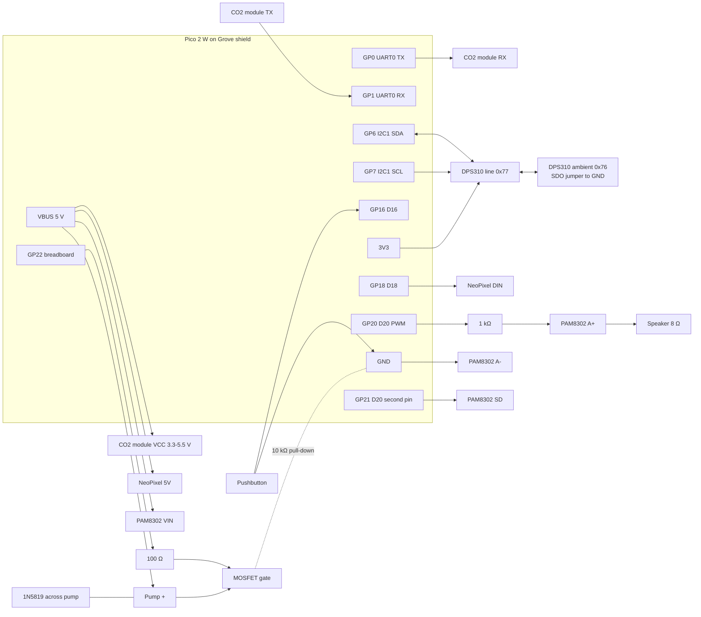
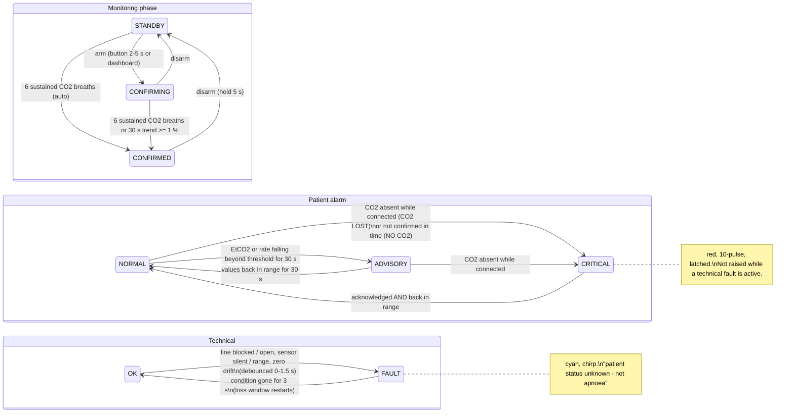
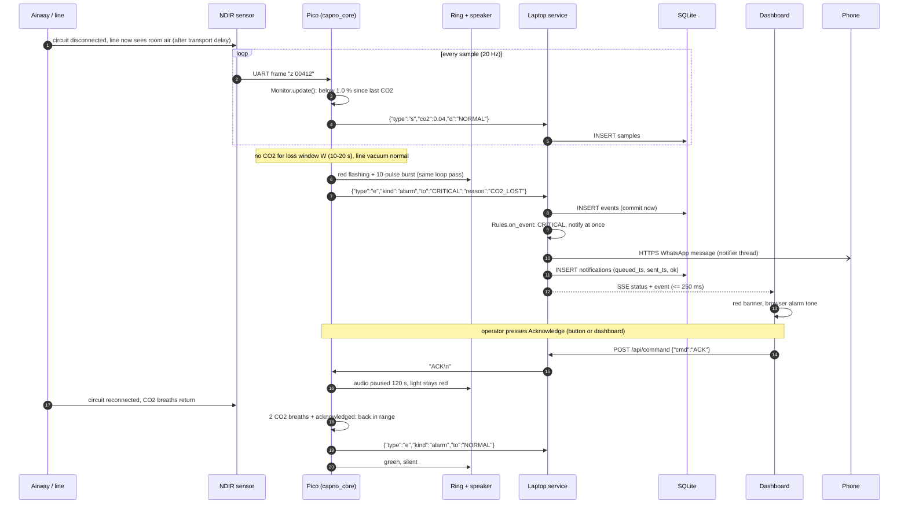

# D4 — System diagram set

Four diagrams: block, wiring, alarm state chart, and the sequence from sample
to notification. They are written in Mermaid so they render on GitHub and stay
in version control next to the code they describe; export to draw.io or PNG
for the dossier.

## 1. Block diagram

```mermaid
flowchart LR
  subgraph Patient side
    A[Airway, mask or test lung]
  end
  subgraph S1[Bedside unit]
    L[Sampling line + water trap] --> C[NDIR CO2 cell]
    C --> P[Pump]
    P -. inlet pressure .-> PL[DPS310 line]
    PA[DPS310 ambient]
    C -- UART --> MCU[Pico 2 W<br/>capno_core]
    PL -- I2C --> MCU
    PA -- I2C --> MCU
    MCU --> RING[NeoPixel ring]
    MCU --> SPK[PAM8302 + speaker]
    BTN[Pushbutton] --> MCU
  end
  A -- gas --> L
  REF[Simulation lab capnograph] -. calibration and validation only .-> L
  MCU <-- USB serial JSON lines --> SVC
  subgraph S2[Laptop]
    SVC[capno_service<br/>ingest + rules] --> DB[(SQLite)]
    SVC --> API[FastAPI REST + SSE]
    SVC --> NTF[Notifier]
  end
  API -- HTTP --> UI[Browser dashboard<br/>audible alert]
  NTF -- HTTPS --> PH[Registered phones]
  DB --> AN[capno_analysis] --> PROF[response_profile.json]
  PROF --> API
  PROF -. pasted into config.py .-> MCU
```

## 2. Wiring diagram



| Pico pin | Grove port | Connects to | Notes |
|---|---|---|---|
| GP0 / GP1 | UART0 | CO2 module RX / TX | 3.3 V logic. Check the module's pinout; SprintIR TX is 3.3 V |
| GP6 / GP7 | I2C1 | Both DPS310 via STEMMA QT daisy chain | Second DPS310: SDO to GND → address 0x76 |
| GP16 | D16 | Pushbutton to GND | internal pull-up |
| GP18 | D18 | NeoPixel ring DIN | ring 5 V from VBUS; add 330 Ω in series and 470 µF across 5 V if flicker |
| GP20 | D20 | 1 kΩ → PAM8302 A+ | A− to GND; volume trim on the PAM8302 |
| GP21 | D20 (2nd pin) | PAM8302 SD | high = enabled |
| GP22 | breadboard | 100 Ω → MOSFET gate | 10 kΩ gate pull-down; pump between VBUS and drain; Schottky across pump |
| VBUS / GND | — | ring, amplifier, pump, CO2 module | total ≤ 500 mA from USB; measure with the multimeter |

Fritzing or KiCad versions of this drawing go in `hardware/` when drawn.

## 3. Alarm state chart

Patient alarm (left) and technical faults (right) are independent; the display
shows the highest priority: CRITICAL > TECHNICAL > ADVISORY > NORMAL.



## 4. Sequence: from sample to notification

Disconnection during a confirmed case.


